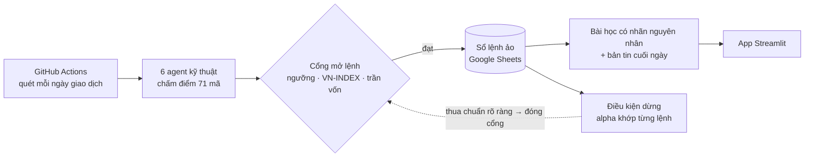

# vibe-stock-analysis

[](https://github.com/Siner0808/vibe-stock-analysis/actions/workflows/kiem-dinh.yml)


**Một agent tự giao dịch ẢO cổ phiếu Việt Nam, tự ghi bài học sau mỗi lệnh — và một bộ
dụng cụ đo được dựng để bắt chính nó nói dối.**

71 mã thuộc 16 ngành · dữ liệu [vnstock](https://vnstocks.com) · quét tự động trên GitHub
Actions · sổ lệnh ảo trên Google Sheets · giao diện Streamlit.

> [!WARNING]
> **Không phải khuyến nghị đầu tư, và không đặt lệnh thật.** Máy chuẩn bị → người xác
> nhận → **người** đặt lệnh; không có đường nào trong mã nối tới tài khoản chứng khoán.
> Tới nay hệ thống **chưa chứng minh được lợi thế nào** — xem [Kết quả](#kết-quả-đo-được).

---

## Một ngày của agent



Bên cạnh vòng ấy, app có các lớp **chỉ để xem** (không vào đường sinh lệnh): phân tích cơ
bản, pha Wyckoff, mức Fibonacci, bảng giá năm màu, kế hoạch vào lệnh từng mã.

## Kết quả đo được

Đặt lên đầu, không giấu xuống cuối:

| Câu hỏi | Kết quả | Nguồn |
|---|---|---|
| Điểm tổng hợp có dự báo lợi nhuận 20 phiên sau? | rho **−0,019**, KTC 95% [−0,100 ; +0,064] — **không** | 573 phiên / 10 mã, [`MO-XE-KIEN-TRUC.md`](MO-XE-KIEN-TRUC.md) |
| Walk-forward ngoài mẫu, chi phí thực thi thật, danh mục theo ngày | 619 lệnh · alpha **−1,68%/lệnh**, KTC [−2,24 ; −1,08] — **thua rổ chuẩn** | ĐO 22, 30/09/2026 · bảng đầy đủ ở [`CLAUDE.md`](CLAUDE.md) |
| Kế hoạch vào lệnh (vùng chờ, cắt lỗ theo cấu trúc) có hơn mua mọi tín hiệu? | Δ alpha **+0,21** điểm %, KTC [−0,16 ; +0,57] — **chưa phân biệt được** | ĐO 25, 12/10/2026 · [`docs/STATE.md`](docs/STATE.md) BƯỚC 179 |

Nguyên nhân gốc không nằm ở mã: cả sáu agent tính từ **cùng một chuỗi giá**. *Phần đo được
thì không có tín hiệu; phần có thể có tín hiệu thì chưa đo được.*

## Vì sao repo này đáng đọc

Dự án đã **năm lần** cho ra con số rất đẹp rồi hoá ra vô nghĩa — `+22,42%`, `+14,88%`,
`+14,24%`, `+636,11%` (đòn bẩy ẩn 2,2 lần), và lần thứ năm là chính giao diện vẫn khoe
`+636,11%` nhiều ngày sau khi con số ấy đã bị bác. Không lần nào cố ý. Từ đó có:

> **Quy tắc số 1 — nếu một thay đổi làm con số đẹp lên đáng kể, giả định đầu tiên là CÓ LỖI.**

Phần lớn công sức vì thế nằm ở hàng rào chống tự lừa mình:

- 🧾 **Khai trước, đo sau.** Tiêu chí của phép đo được ký và commit **riêng**, trước khi chạy
  và trước khi thấy số ([`docs/TIEU-CHI-DOC-TRUOC.md`](docs/TIEU-CHI-DOC-TRUOC.md)) — lịch sử git
  chứng minh thứ tự, không ai phải tin lời hứa.
- 🧬 **Đột biến mọi hàng rào mới.** Sửa mã cho sai đi, test phải ĐỎ; một gác vừa viết xong mà
  chưa bị đục thử được coi là chưa có.
- 🚦 **Ba trạng thái, không hai.** Mọi phép kiểm phân biệt *đạt* / *không đạt* / **chưa kiểm
  được** — và trạng thái thứ ba không bao giờ được gộp vào trạng thái đầu.
- 📓 **Nhật ký ghi cả cái sai.** [`docs/STATE.md`](docs/STATE.md) giữ từng bước: đo được gì, giả
  thuyết nào bị bác, ước lượng nào đã trượt; bảng lỗi quy trình ghi từng lỗi và "máy chặn được
  chưa".

## Lộ trình

Hai đích, nhịp khác nhau ([`docs/LO-TRINH.md`](docs/LO-TRINH.md), người dùng duyệt 08/10/2026):

- **Đích 1 — "máy học được"**, v1.0 ngày **28/02/2027**: agent tự giao dịch ảo, tự rút bài
  học, minh bạch; nghiệm thu bằng bảy tiêu chí đo được.
- **Đích 2 — "có lợi thế thật"**: ứng viên đầu tiên (UV-001) đã khai công khai từ 02/10/2026 và
  chỉ được đọc **một lần**, khoảng đầu tháng 11/2027 (ƯỚC LƯỢNG). Kết cục "không có lợi thế" là
  một kết quả hợp lệ.

## Chạy thử

Cần Python 3.11. Sau khi clone, tạo một môi trường ảo tên `.venv` trong thư mục repo, rồi
(đường dưới là của Windows; Linux/macOS dùng `.venv/bin/python`):

```bash
git clone https://github.com/Siner0808/vibe-stock-analysis.git
cd vibe-stock-analysis
./.venv/Scripts/python.exe -m pip install -r requirements.txt
./.venv/Scripts/python.exe -m streamlit run app.py
./.venv/Scripts/python.exe -m pytest tests/ -q
```

Lệnh cuối chạy toàn bộ test — offline, không cần mạng hay khoá. Kho ngoài (Google Sheets) là tuỳ chọn: chép `.streamlit/secrets.toml.example` thành
`.streamlit/secrets.toml` rồi điền; không cấu hình thì phần ấy tắt sạch, app vẫn chạy.
**Đừng commit file `secrets.toml`.**

## Tài liệu

| Bắt đầu từ | Để biết |
|---|---|
| [`docs/HANDOFF.md`](docs/HANDOFF.md) | hệ thống đang ở đâu, lệnh đầu tiên nên chạy |
| [`docs/LO-TRINH.md`](docs/LO-TRINH.md) | đi tới đâu, theo mốc nào |
| [`NGUYEN-TAC-DO-LUONG.md`](NGUYEN-TAC-DO-LUONG.md) | tám bất biến đo lường — đọc trước khi sửa bất cứ thứ gì chạm kết quả |
| [`MO-XE-KIEN-TRUC.md`](MO-XE-KIEN-TRUC.md) · [`architecture_asbuilt.html`](architecture_asbuilt.html) | thành phần nào chạy thật, thành phần nào là trang trí |
| [`docs/STATE.md`](docs/STATE.md) | nhật ký từng bước |
| [`CLAUDE.md`](CLAUDE.md) · [`.claude/skills/quy-trinh-lam-viec/`](.claude/skills/quy-trinh-lam-viec/SKILL.md) | luật hiện hành và quy trình bắt buộc cho người lẫn agent AI |

## Giấy phép

Chưa có. Mặc định là **giữ toàn quyền** — muốn dùng lại, hãy mở issue hỏi trước. Dữ liệu thị
trường thuộc nhà cung cấp tương ứng; tài liệu kỹ thuật của gói vnstock **không** được lưu trong
repo này, đúng giấy phép của nó.
